# Solve the linear Schrödinger equation in 1D using a Physics Informed Neural Network

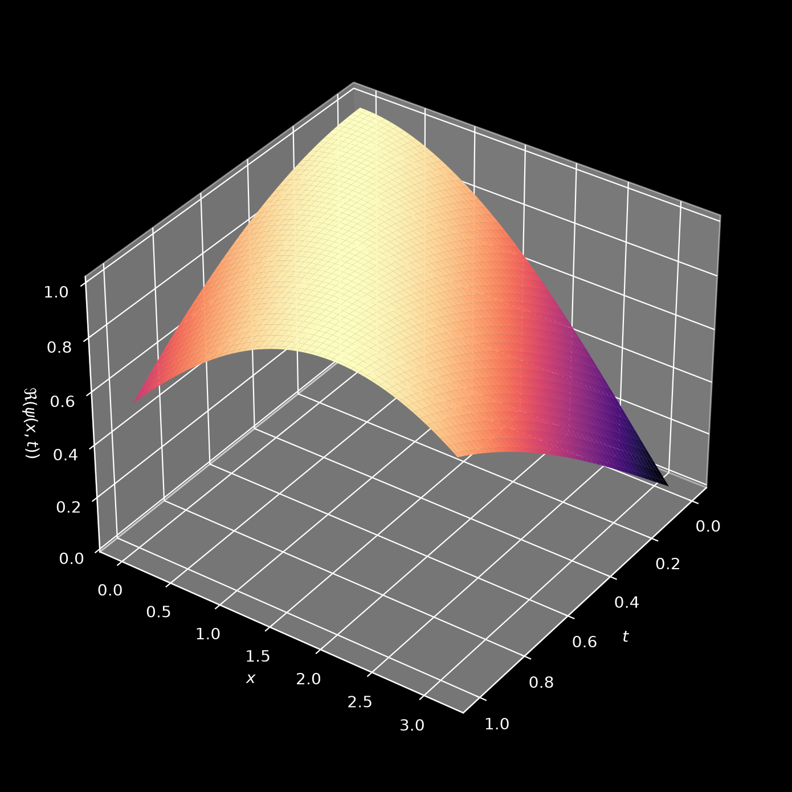

This code heavily draws on the implementation of the PINN approach published by Jan Blechschmidt under https://github.com/janblechschmidt/PDEsByNNs/ (MIT license) and was further developed using Claude. 


## Explanation
In the following, we will solve the dimensionless 1D Schrödinger equation with inhomogeneous Dirichlet boundary conditions using a Physics Informed Neural Network (PINN).
This boundary values problem can be stated as

$$i \hbar \partial_t \psi(x, t) = \left(-\frac{\hbar^2}{2m}\partial_x^2 + V(x, t)\right) \psi(x, t)$$
with
$$\psi(x, t = t_0) \equiv \psi_0(x) \qquad \psi(x=x_l, t) \equiv \psi_L(t) \qquad \psi(x=x_r, t) \equiv \psi_R(t)$$
for $t \in [t_0, t_1]$ and $x \in [x_l, x_r]$ and $\psi \in C_2([t_0, t_1] \times [x_l, x_r], \mathbb{C})$.

In the first approach considered here - the continuous time approach - we approximate $\psi(x, t)$ via a neural network $\psi_{\theta}(x, t)$ that takes two input parameters and outputs two ouput parameters - the real and imaginary part of the wave function. Note that we approximate the wave function in both spatial and temporal dimensions. In order for the NN to satisfy the boundary value problem, the residual of the PDE

$$r_{\theta}(x, t) \equiv \left(i \hbar \partial_t + \frac{\hbar^2}{2m} \partial_x^2 - V(x, t)\right)\psi_{\theta}(x, t)$$
is included in the loss functional. In total, the loss functional then contains three terms:
 - The mean squared residual
 - The mean squared misfit w.r.t. initial conditions
 - The mean squared misfit w.r.t. boundary conditions

It is minimised over a number of collocation points that are randomly sampled from $[t_0, t_1] \times [x_l, x_r]$.


## Files

| File | Description |
|---|---|
| `1_linear_schroedinger_1d.ipynb` | Original TensorFlow implementation (continuous time) |
| `2_linear_schroedinger_1d_discrete_time.ipynb` | Original TensorFlow implementation (discrete time) |
| `3_benchmark_resolution.py` | Resolution and step-size benchmarks of both PINNs against classical solvers (PyTorch, standalone) |
| `5_benchmark_strategies.py` | Ablation of Fourier features, adaptive loss weights and random weight factorisation for the discrete time PINN; builds on `3_benchmark_resolution.py` |
| `6_benchmark_schroedinger_poisson.py` | Discrete time PINN vs. split-step Fourier for one step of the periodic 1D Schrödinger-Poisson system with a few random modes; builds on `3_` and `5_` |
| `7_improve_schroedinger_poisson.py` | Levenberg-Marquardt, stage-derivative form and interaction picture for the Schrödinger-Poisson PINN, plus a regression diagnostic; builds on `6_` |

## Performance comparison

Both TensorFlow notebooks solve the same plane wave test problem on $x \in [0, 1]$, $t \in [0, \pi]$ with 5000 Adam iterations and the same learning rate schedule, run on CPU on the same machine.

| | Continuous time | Discrete time |
|---|---|---|
| Training points per iteration | 10000 collocation + 50 initial + 50 boundary | 100 initial + 2 boundary |
| Network outputs | 2 | 2(q+1) = 514 (q = 256 IRK stages) |
| Training time | 398 s | 37 s |
| Final loss | 1.2e-5 | 1.5e-6 |
| L1 error | 0.0006 (random test points in $x$–$t$) | 0.0015 (at $t_1$) |
| Mean density $\lvert\psi\rvert^2$ (exact: 1) | 0.9999 | 0.996 |

The discrete time approach trains about 11 times faster because the IRK scheme replaces the collocation points in time. Note that the L1 errors are evaluated on different points: over the whole domain for the continuous time approach and at the final time $t_1$ for the discrete time approach.

## Resolution benchmark

`3_benchmark_resolution.py` compares how the error of both PINNs depends on resolution with that of classical solvers.

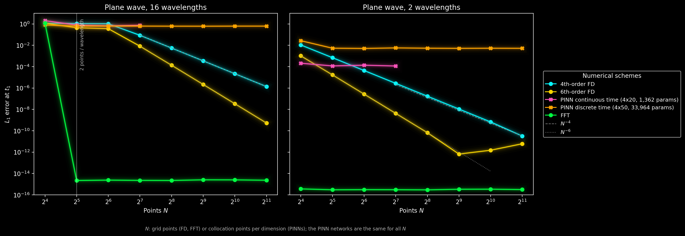

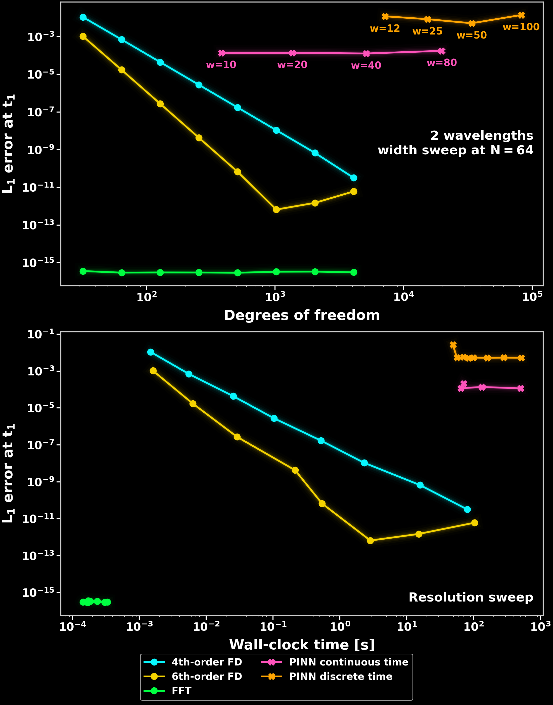

### Setup

- **Test problem:** plane wave $\psi = e^{i(kx - \omega t)}$ with $\omega = k^2/2$ on $x \in [0, 1]$, for 16 wavelengths (as in the paper, where $N = 2^5$ is two points per wavelength) and for 2 wavelengths. The wave travels a third of the domain until $t_1$. This avoids $\omega t_1$ being a multiple of $2\pi$, which would make the aliased solution at $N = 16$ exact by accident.
- **PINNs:** both notebook methods, ported to PyTorch in float64. Each is trained with 2000 Adam steps followed by 1500 L-BFGS steps. The networks are the notebook defaults: 4×20 for continuous time (1,362 parameters) and 4×50 for discrete time with $q = 256$ (33,964 parameters). The PDE residual of the continuous time PINN is divided by $\omega$ so that it is of the same order as the initial and boundary terms.
- **References:** 4th- and 6th-order central finite differences with RK4 at half the stability limit, and an FFT solver with exact time integration, all on a periodic grid.
- **Resolution $N$:** grid points for FD and FFT; collocation points per dimension for the PINNs ($N \times N$ in space-time for continuous time, $N$ initial points for discrete time). The networks stay the same for all $N$. The continuous time PINN is capped at $N = 2^7$ for runtime reasons.
- **Error:** mean $L_1$ error of real and imaginary part at $t_1$, $\frac{1}{2}\,\mathrm{mean}(|\Delta \mathrm{Re}\,\psi| + |\Delta \mathrm{Im}\,\psi|)$.

### Results

| | 16 wavelengths | 2 wavelengths |
|---|---|---|
| FD 4th / 6th order | Clean $N^{-4}$ / $N^{-6}$ | Same slopes; 6th order reaches round-off (about $10^{-12}$) from $N = 2^9$ |
| FFT | About $10^{-15}$ from two points per wavelength | About $10^{-16}$ |
| Continuous time PINN | Fails, error 0.7–2 at every $N$ | Flat at about $1.2 \times 10^{-4}$ from $N = 2^4$ |
| Discrete time PINN | Fails, error about 0.63 at every $N$ | Flat at about $5 \times 10^{-3}$ from $N = 2^5$ |

- **16 wavelengths:** neither PINN learns the solution at any resolution, not even where 4th-order FD already reaches $10^{-6}$. This is spectral bias: plain tanh networks learn high frequencies very slowly ([Rahaman et al. 2019](https://arxiv.org/abs/1806.08734); [Wang, Yu & Perdikaris, JCP 2022](https://arxiv.org/abs/2007.14527)).
- **2 wavelengths:** the PINN errors do not decrease with $N$. The final loss is the same for every $N$ (about $6 \times 10^{-6}$ for discrete time, about $5 \times 10^{-7}$ for continuous time), so the optimiser limits the accuracy, not the number of collocation points.
- **Network size barely matters:** across widths from 382 to 82k parameters at $N = 64$, the continuous time PINN stays at $1.3$–$1.8 \times 10^{-4}$, and the discrete time PINN gets worse from width 50 to width 100. At equal degrees of freedom, FD is 5–10 orders of magnitude more accurate and about 1000 times faster.
- **Continuous vs. discrete time:** the continuous time PINN is about 40 times more accurate with about 25 times fewer parameters. Most parameters of the discrete time PINN sit in its 514-output final layer.
- **Caveat:** one seed per point, so expect PINN values to scatter by roughly a factor of 2 between seeds.

### Network size vs. grid points

There is no established mapping like "number of network parameters = number of grid points". A PINN has two separate resolutions:

- **Collocation points** play the role of quadrature nodes. The generalisation error is bounded by the training error plus a quadrature term that decays as $N_\mathrm{colloc}^{-\alpha}$, with $\alpha = 1/2$ for random sampling and higher for grid or quasi-Monte Carlo points ([Mishra & Molinaro, IMA J. Numer. Anal. 2023](https://arxiv.org/abs/2006.16144)).
- **Network width and depth** set how rich the approximation is, similar to the polynomial order or number of basis functions, not the grid ([De Ryck, Lanthaler & Mishra, Neural Networks 2021](https://arxiv.org/abs/2104.08938)).

In practice, neither usually limits accuracy: optimisation does ([Krishnapriyan et al., NeurIPS 2021](https://arxiv.org/abs/2109.01050)). This is why the benchmark also plots the error against degrees of freedom and wall-clock time, following the recommendation to compare at equal accuracy or equal runtime by [McGreivy & Hakim (Nat. Mach. Intell. 2024)](https://arxiv.org/abs/2407.07218) and [Grossmann et al. (IMA J. Appl. Math. 2024)](https://arxiv.org/abs/2302.04107).

Fourier feature embeddings against spectral bias ([Tancik et al. 2020](https://arxiv.org/abs/2006.10739); [Wang, Wang & Perdikaris 2021](https://arxiv.org/abs/2012.10047)) and adaptive loss weighting against the plateau are tested in the [strategy benchmark](#strategy-benchmark) below.

## Step-size benchmark

The discrete time approach promises large time steps, since the implicit Gauss-Legendre scheme has no stability limit. The step-size benchmark tests whether this carries over to the PINN.

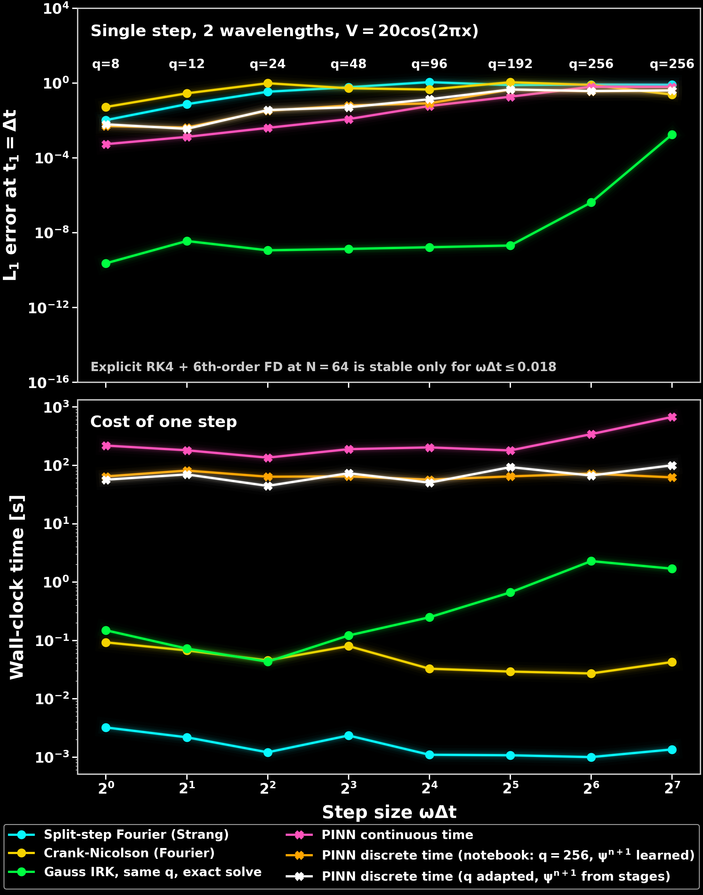

### Setup

- **Test problem:** plane wave with 2 wavelengths in the periodic potential $V(x) = 20\cos(2\pi x)$, advanced by a single step of size $\omega\Delta t = 1, \dots, 128$ with $\omega = k^2/2$. Without a potential, the Fourier propagator would be exact for any step size; the potential is what makes the classical solvers depend on the step size, as in Schrödinger-Poisson. The exact solution is computed from the eigen-decomposition of the Hamiltonian in a truncated Fourier basis.
- **PINNs** (same training and networks as above, $N = 64$ collocation points per dimension):
  - discrete time as in the notebook ($q = 256$, $\psi^{n+1}$ as a network output)
  - discrete time with $q$ adapted to the step (smallest Gauss-Legendre scheme with a temporal error below $10^{-8}$) and $\psi^{n+1} = \psi_0 + \Delta t \sum_k b_k \mathcal{N}[\psi_k]$ computed from the stages
  - continuous time on $[0, \Delta t]$ with 16 collocation points per period in $t$
- **Classical single steps:** split-step Fourier (Strang), Crank-Nicolson, and the Gauss-Legendre scheme with the same $q$ solved exactly by linear algebra, i.e. what a perfectly trained discrete time PINN would achieve.

### Results

| $\omega\Delta t$ | 1 | 4 | 16 | 32 | 128 |
|---|---|---|---|---|---|
| Required stages $q$ | 8 | 24 | 96 | 192 | > 256 |
| Gauss IRK, exact solve | $2 \times 10^{-10}$ | $1 \times 10^{-9}$ | $2 \times 10^{-9}$ | $2 \times 10^{-9}$ | $2 \times 10^{-3}$ ($q$ capped at 256) |
| PINN discrete time (notebook) | $5 \times 10^{-3}$ | $3 \times 10^{-2}$ | $8 \times 10^{-2}$ | 0.45 | 0.41 |
| PINN discrete time ($q$ adapted) | $6 \times 10^{-3}$ | $4 \times 10^{-2}$ | 0.14 | 0.45 | 0.40 |
| PINN continuous time | $5 \times 10^{-4}$ | $4 \times 10^{-3}$ | $6 \times 10^{-2}$ | 0.19 | 0.63 |
| Split-step Fourier (Strang) | $1 \times 10^{-2}$ | 0.35 | 1.1 | 0.78 | 0.81 |

- **The time scheme allows large steps, the PINN does not deliver them.** Solved exactly, the Gauss-Legendre scheme stays at about $10^{-9}$ up to $\omega\Delta t = 32$. The discrete time PINNs solving the same equations are 7–8 orders of magnitude less accurate, and their error grows with the step size until they fail completely at $\omega\Delta t \approx 32$.
- **No free lunch in time.** The number of stages needed grows linearly with the step, $q \approx 3\,\omega\Delta t$, because every Fourier mode excited by the potential has to be resolved in phase. A large step does not remove temporal degrees of freedom; it moves them into the stages.
- **Training gets harder with the step size.** The final loss grows from about $10^{-5}$ at $\omega\Delta t = 1$ to about $5 \times 10^{-4}$ at $\omega\Delta t \geq 32$. Errors in the curvature of the stages enter the IRK update multiplied by $\omega\Delta t$.
- **Adapting $q$ and computing $\psi^{n+1}$ from the stages does not help.** Both discrete time variants perform the same, so the number of outputs and the loss weighting of $\psi^{n+1}$ are not what limits accuracy. The continuous time PINN is about 10 times more accurate at $\omega\Delta t = 1$, but its advantage shrinks with the step size and is gone by $\omega\Delta t = 16$.
- **Single-step comparisons with second-order schemes are misleading.** The discrete time PINN beats one Strang or Crank-Nicolson step for $\omega\Delta t \geq 2$, but those schemes are meant for small steps: they need milliseconds per step, whereas training one PINN step takes 1–10 minutes.

For Schrödinger-Poisson this means that large time steps are better obtained with classical implicit or exponential integrators (or the phase-free Madelung formulation) than with a discrete time PINN.

## Strategy benchmark

`5_benchmark_strategies.py` tests whether improvements from the literature fix the three failures of the discrete time PINN found above: spectral bias (16 wavelengths), the error plateau (2 wavelengths) and the failure at large steps. Every improvement is run alone and in all combinations ($2^3$ variants per problem), so that each effect can be separated.

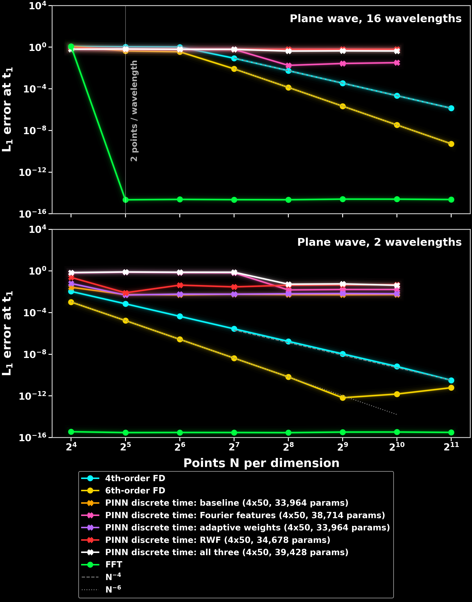

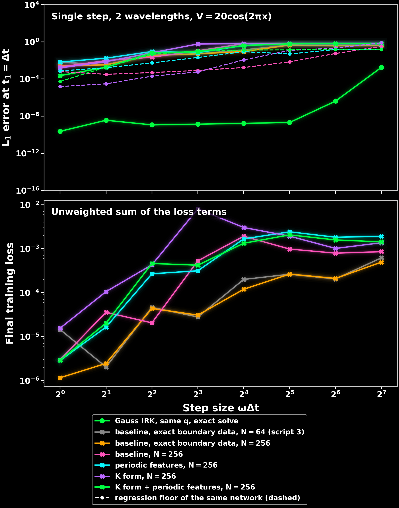

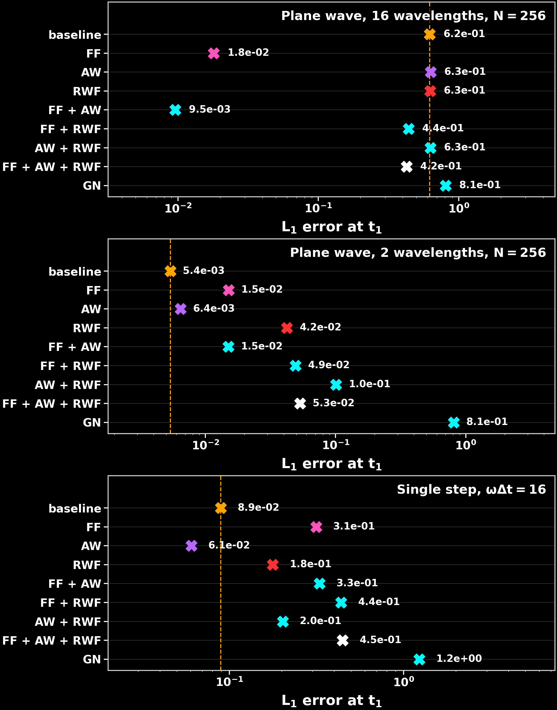

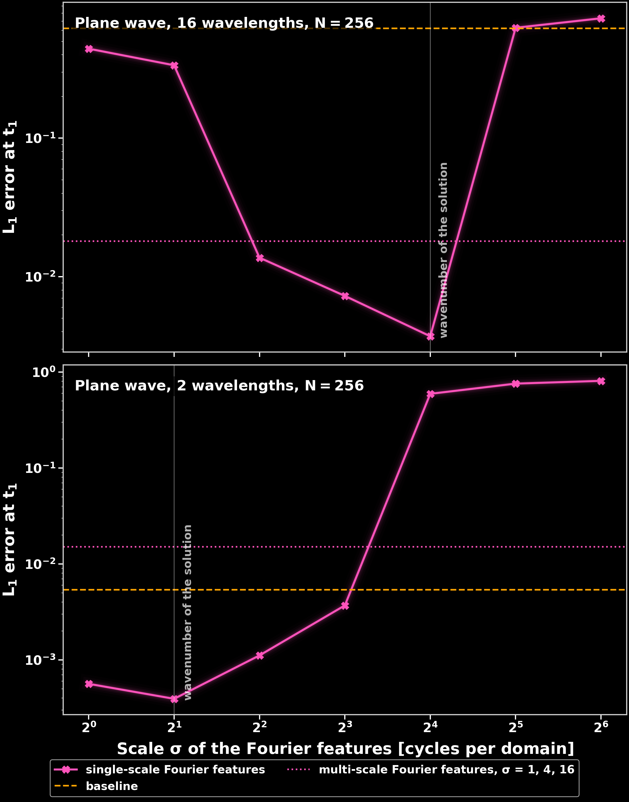

### Setup

- **Fourier features (FF)** against spectral bias: the input is embedded in random features $[\sin(2\pi f x), \cos(2\pi f x)]$. Multi-scale and the same for every problem: 16 frequencies from each of three Gaussians with standard deviations $\sigma = 1, 4, 16$ cycles per domain. The derivatives of the embedding are propagated analytically.
- **Adaptive weights (AW)** against the plateau: relative loss balancing of the IRK reconstruction term and the boundary term, simplified from [Bischof & Kraus 2021](https://arxiv.org/abs/2110.09813). Updated every 10 Adam steps, frozen for L-BFGS. The more cited gradient-norm balancing of [Wang, Teng & Perdikaris 2021](https://arxiv.org/abs/2001.04536) (GN) is run alone for comparison.
- **Random weight factorisation (RWF)** $W = \mathrm{diag}(e^s)\,V$ of all layers ([Wang et al. 2022](https://arxiv.org/abs/2210.01274)).
- Everything else as in the resolution benchmark: discrete time PINN 4×50, 2000 Adam + 1500 L-BFGS steps, one seed. Baselines are the results of `3_benchmark_resolution.py`. The step-size benchmark uses $q$ adapted to the step and $N = 256$ collocation points instead of 64, because FF alias on a grid that does not resolve their frequencies (see below).
- The strategies use generic defaults and were not tuned.

### Results

$L_1$ error at $N = 256$ (16 points per wavelength for 16 waves) and for one step of $\omega\Delta t = 16$:

| | 16 waves | 2 waves | step, $\omega\Delta t = 16$ |
|---|---|---|---|
| Baseline | 0.62 | $5.4 \times 10^{-3}$ | $8.9 \times 10^{-2}$ |
| FF | $1.8 \times 10^{-2}$ | $1.5 \times 10^{-2}$ | 0.31 |
| AW | 0.63 | $6.4 \times 10^{-3}$ | $6.1 \times 10^{-2}$ |
| RWF | 0.63 | $4.2 \times 10^{-2}$ | 0.18 |
| FF + AW | $9.5 \times 10^{-3}$ | $1.5 \times 10^{-2}$ | 0.33 |
| FF + RWF | 0.44 | $4.9 \times 10^{-2}$ | 0.44 |
| AW + RWF | 0.63 | 0.10 | 0.20 |
| FF + AW + RWF | 0.42 | $5.3 \times 10^{-2}$ | 0.45 |
| Gradient-norm weights (GN) | 0.81 | 0.81 | 1.2 |
| *FF with a single $\sigma$ equal to the wavenumber* | $3.7 \times 10^{-3}$ ($\sigma = 16$) | $3.9 \times 10^{-4}$ ($\sigma = 2$) | |
| *4th / 6th-order FD* | $5.6 \times 10^{-3}$ / $1.4 \times 10^{-4}$ | $1.7 \times 10^{-7}$ / $7 \times 10^{-11}$ | |

Single steps of different size ($N = 256$):

| $\omega\Delta t$ | 1 | 4 | 16 | 32 | 128 |
|---|---|---|---|---|---|
| Gauss IRK, exact solve | $2 \times 10^{-10}$ | $1 \times 10^{-9}$ | $2 \times 10^{-9}$ | $2 \times 10^{-9}$ | $2 \times 10^{-3}$ |
| Baseline | $2.6 \times 10^{-3}$ | $3.4 \times 10^{-2}$ | $8.9 \times 10^{-2}$ | 0.45 | 0.40 |
| FF | $5.6 \times 10^{-3}$ | $5.8 \times 10^{-2}$ | 0.31 | 0.45 | 0.41 |
| AW | $6.5 \times 10^{-3}$ | $1.7 \times 10^{-2}$ | $6.1 \times 10^{-2}$ | 0.42 | 0.39 |
| RWF | $2.3 \times 10^{-3}$ | $1.4 \times 10^{-2}$ | 0.18 | 0.45 | 0.42 |
| FF + AW + RWF | $5.6 \times 10^{-3}$ | $4.7 \times 10^{-2}$ | 0.45 | 0.47 | 0.60 |

- **Fourier features are the only improvement that helps against spectral bias**, and only if the grid resolves them. For 16 waves the error drops from 0.62 to $1.8 \times 10^{-2}$ at $N = 256$, but not below: for $N \leq 128$ the training loss falls to $10^{-6}$–$10^{-7}$ while the error stays at 0.6. The network fits the collocation points but not the space between them. At $N = 128$ the prediction is dominated by the wrong-sign wave ($-16$ instead of $+16$ cycles), and the features reach up to about 50 cycles. Beyond $N = 256$ the error does not improve further ($1.8$, $2.7$, $3.3 \times 10^{-2}$ for $N = 2^8, 2^9, 2^{10}$), while FD keeps converging at $N^{-4}$ and $N^{-6}$.
- **The scale of the features has to match the solution.** With a single $\sigma$ at $N = 256$, the error is lowest for $\sigma$ at the wavenumber of the solution ($\sigma = 16$ for 16 waves, $\sigma = 1$–$2$ for 2 waves) and fails for $\sigma$ well below it (like the baseline) or above it ($\sigma \geq 32$ for 16 waves, $\sigma \geq 16$ for 2 waves). The generic multi-scale set costs a factor of 5 (16 waves) to 40 (2 waves) against the matched choice and is 3 times worse than the baseline for 2 waves, since most of its features are far too fast. The matched values use knowledge of the solution and are an upper bound of what FF can do.
- **The plateau is not a weighting problem.** AW leaves the 2-wave error at $6.4 \times 10^{-3}$ (baseline $5.4 \times 10^{-3}$) and the final loss at the same level (about $9 \times 10^{-6}$ instead of $6 \times 10^{-6}$). Only FF with a matched $\sigma$ breaks the plateau, by a factor of 10 in error and 20 in loss ($3 \times 10^{-7}$ instead of $6 \times 10^{-6}$), at the same optimiser budget. The plateau therefore looks like a difficulty of the tanh network with oscillating targets, a milder form of spectral bias.
- **Gradient-norm balancing diverges.** The boundary term has only two points and is satisfied almost immediately. Its gradient then vanishes and the rule keeps raising its weight (to about $10^6$). The network ends up on the trivial solution with loss 1.0. In a 400-step Adam test, fixed boundary weights of 3 or 30 already slowed down the learning of the IRK term. Relative loss balancing reacts to which term stalls instead and is harmless, but does not help either. Capping the boundary weight does not fix it: in a single check (2 waves, $N = 64$) a cap of 100 still ends at loss 0.28 and error 0.45 (uncapped: loss 1.0, error 0.81; baseline: $6.8 \times 10^{-6}$, $5.2 \times 10^{-3}$). The rule does not suit a loss with no separate PDE residual term and a 2-point boundary term.
- **RWF does not help and combines badly.** It is 8 times worse for 2 waves and cancels most of the FF gain (16 waves: 0.44 instead of $1.8 \times 10^{-2}$). Most of this comes from the learning rate of the baseline, 0.01, which is too high for RWF: in a single check (2 waves, $N = 64$) with the usual 0.001, RWF reaches $8.1 \times 10^{-3}$ against $5.2 \times 10^{-3}$ for the baseline, i.e. no gain, but within the seed scatter.
- **"Everything together" is not the best combination.** All three together are worse than FF alone. FF + AW is the best generic combination for 16 waves ($9.5 \times 10^{-3}$), but within the seed scatter of FF alone.
- **None of them helps for large steps.** All variants fail at $\omega\Delta t \geq 32$ with an error of about 0.4, where the exactly solved IRK scheme is at $10^{-9}$. AW is up to 2 times better for $\omega\Delta t = 4$–16, within the scatter. FF is up to 3.5 times worse, because the solution has only 2 wavelengths. The final loss grows with the step for all variants, from about $10^{-6}$ to $10^{-3}$ (0.17 for all three together), so the step-size failure is an optimisation problem of the IRK loss and not spectral bias or loss balance.
- **Even the best PINN stays far behind the classical solvers.** For 2 waves at $N = 256$, FD is $10^3$ to $10^7$ times more accurate than the best PINN variant.
- **Caveat:** one seed per point, so expect scatter of roughly a factor of 2; differences smaller than that are not meaningful. Strategy hyperparameters are generic defaults. Periodic Fourier modes, which suit this periodic problem, are tested in the Schrödinger-Poisson benchmark below.

## Schrödinger-Poisson benchmark

`6_benchmark_schroedinger_poisson.py` moves from the plane wave to the periodic 1D Schrödinger-Poisson system $i\psi_t = -\tfrac12\psi_{xx} + V\psi$, $V_{xx} = \kappa(|\psi|^2 - 1)$, with an initial state of a few random Fourier modes, and compares one step of the discrete time PINN with split-step Fourier (SSF). `7_improve_schroedinger_poisson.py` then tests, one at a time, what removes the training limit of the PINN found there.

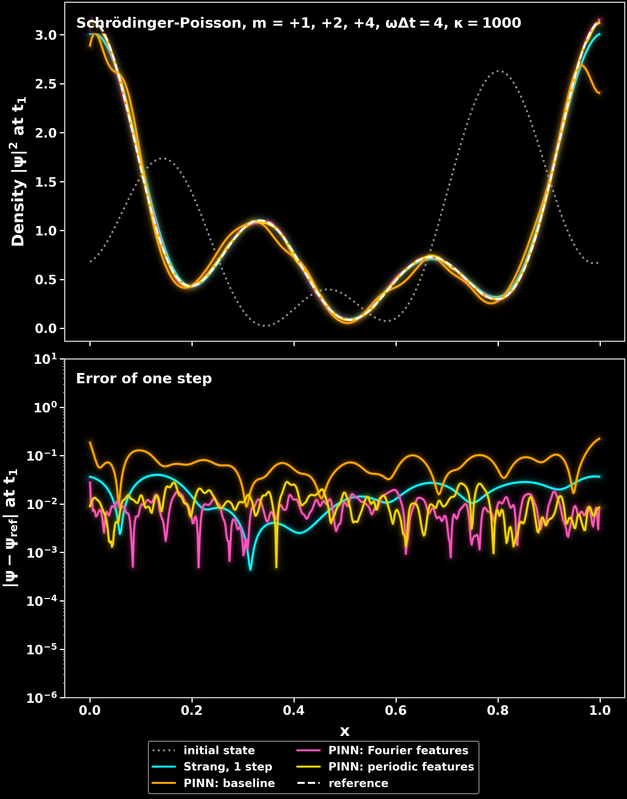

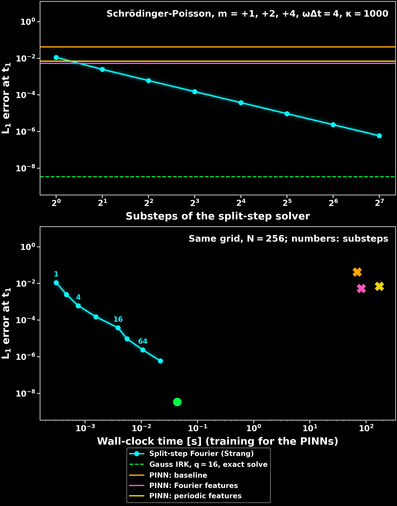

### Setup

- **Problem:** three random nonzero integer modes $m \in \{-4, \dots, 4\}$ with random complex amplitudes (seed 0: $m = 1, 2, 4$), mean density 1, $\kappa = 1000$ (potential rms 15), one step with $\omega\Delta t = 4$, $\omega = \tfrac12(2\pi k_\mathrm{max})^2$, $k_\mathrm{max} = 4$. The step is nonlinear: the potential of every stage comes from a differentiable FFT Poisson solve of $|\psi_k|^2$ on the collocation grid.
- **Reference:** 4th-order (Yoshida) split-step on 1024 points, converged to $10^{-10}$ (checked against half the steps).
- **Classical solvers:** Strang split-step (kick-drift-kick) with 1 to 128 substeps on the same grid; the Gauss-Legendre scheme with the smallest $q$ accurate to $10^{-8}$ ($q = 16$), solved exactly by Newton-Krylov in Fourier space, i.e. what a perfectly trained PINN would achieve.
- **PINN:** as in script 3, one IRK step with $\psi^{n+1}$ computed from the stages, 4×50 tanh network, 2000 Adam + 1500 L-BFGS steps, $N = 256$. Periodicity is a loss term for $\psi$ and $\psi_x$ at $x = 0, 1$. Variants: baseline, FF (script 5) and `per`, periodic features $[\sin(2\pi m x), \cos(2\pi m x)]$, $m = 1..16$, which make the network exactly periodic and drop the boundary term.

### Results of script 6 (one step, $N = 256$)

| | $L_1$ error | time |
|---|---|---|
| Strang, 1 / 4 / 16 / 128 substeps | $1.1 \times 10^{-2}$ / $6.1 \times 10^{-4}$ / $3.8 \times 10^{-5}$ / $5.9 \times 10^{-7}$ | 0.4 / 1.2 / 4.6 / 33 ms |
| Gauss IRK, $q = 16$, exact | $3.5 \times 10^{-9}$ | 40 ms |
| PINN baseline | $4.2 \times 10^{-2}$ | 70 s |
| PINN, Fourier features | $5.3 \times 10^{-3}$ | 82 s |
| PINN, periodic features | $7.0 \times 10^{-3}$ | 172 s |

- **Unlike for the plane wave, features help.** The solution has a broad low-mode spectrum, and FF and periodic features are 6 to 8 times better than the baseline.
- **The PINN matches one to two SSF substeps and takes minutes instead of milliseconds.** The exactly solved scheme is 6 orders of magnitude more accurate than the best PINN, so the limit is training, not the scheme, as for the plane wave.

## Improving the discrete time PINN

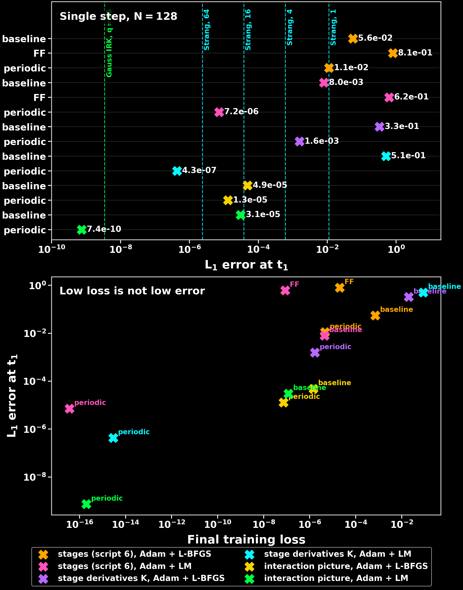

### Experiments

Each is run on the same problem. The Levenberg-Marquardt (LM) runs use $N = 128$ collocation points and 40 iterations, because the dense Jacobian is expensive (about 20 s per iteration at $N = 128$, $q = 16$, 85 s at $N = 256$); all variants in the figure and table are run at $N = 128$, so that they are comparable.

1. **Regression of the exact solution.** The exact IRK stages (values and second derivatives) are fitted with the same networks and optimiser, and $\psi^{n+1}$ is formed from the fit as in the PINN.
2. **Levenberg-Marquardt** (damped Gauss-Newton with a dense Jacobian) instead of L-BFGS after the Adam phase, on the same loss.
3. **Stage derivative form (K).** The network outputs $K_i = \mathcal{N}[\psi_i]/\omega$ and the stages are $\psi_i = \psi_0 + \Delta t\,\omega \sum_j a_{ij} K_j$. The initial data is exact, the residual is $K_i - \mathcal{N}[\psi_i]/\omega$, and $\psi^{n+1} = \psi_0 + \Delta t\,\omega\sum_i b_i K_i$ needs no derivative of the network.
4. **Interaction picture (IP).** Lawson-type exponential IRK: the free propagator is applied exactly in Fourier space and the network represents $\varphi_i = e^{-\frac{i}{2} c_i \Delta t\,\partial_{xx}}\psi_i$. All derivatives are spectral, so the loss is evaluated on the collocation grid only. This is a spectral collocation method with a network as the parametrisation, not a PINN in the strict sense. $q$ drops from 16 to 12.

### Results ($N = 128$, seed 0, $\omega\Delta t = 4$)

| Form | Optimiser | baseline | FF | periodic |
|---|---|---|---|---|
| Stages (script 6) | Adam + L-BFGS | $5.6 \times 10^{-2}$ (loss $7 \times 10^{-4}$) | 0.81 ($2 \times 10^{-5}$) | $1.1 \times 10^{-2}$ ($5 \times 10^{-6}$) |
| Stages | Adam + LM | $8.0 \times 10^{-3}$ ($4 \times 10^{-6}$) | 0.62 ($9 \times 10^{-8}$) | $7.2 \times 10^{-6}$ ($4 \times 10^{-17}$) |
| K | Adam + L-BFGS | 0.33 ($2 \times 10^{-2}$) | | $1.6 \times 10^{-3}$ ($2 \times 10^{-6}$) |
| K | Adam + LM | 0.51 ($9 \times 10^{-2}$) | | $4.3 \times 10^{-7}$ ($3 \times 10^{-15}$) |
| IP ($q = 12$) | Adam + L-BFGS | $4.9 \times 10^{-5}$ ($1 \times 10^{-6}$) | | $1.3 \times 10^{-5}$ ($7 \times 10^{-8}$) |
| IP ($q = 12$) | Adam + LM | $3.1 \times 10^{-5}$ ($1 \times 10^{-7}$) | | $7.4 \times 10^{-10}$ ($2 \times 10^{-16}$) |

$L_1$ error with the final training loss in brackets. For reference: Strang with 1 / 4 / 16 / 64 substeps $1.1 \times 10^{-2}$ / $6 \times 10^{-4}$ / $4 \times 10^{-5}$ / $2.4 \times 10^{-6}$, exact IRK $3.5 \times 10^{-9}$. Wall-clock time: 30 to 170 s for the L-BFGS runs, 4 to 14 min for the LM runs.

- **The error is optimisation-limited, not representation-limited.** Regressing the exact stages with the same networks and optimiser gives $5.6$ to $6.2 \times 10^{-4}$ for all three networks ($N = 256$), 9 to 75 times better than the PINN trained on the equations ($4.2 \times 10^{-2}$, $5.3 \times 10^{-3}$, $7.0 \times 10^{-3}$).
- **LM is the largest single lever.** On the baseline it lowers the final loss from $7 \times 10^{-4}$ to $4 \times 10^{-6}$ and the error from $5.6 \times 10^{-2}$ to $8 \times 10^{-3}$, and the loss was still falling about 10× per 10 iterations when the budget ended. Combined with exact periodicity the loss reaches machine precision ($4 \times 10^{-17}$) after 30 iterations and the error $7 \times 10^{-6}$, equal to Strang with about 32 substeps and 1500 times better than the same network with L-BFGS. Periodic features alone (L-BFGS) are not enough: the gain comes from the combination.
- **A low loss is not a low error.** FF + LM reaches a loss of $9 \times 10^{-8}$ and an error of 0.62. At $N = 128$ the grid does not resolve the features (up to about 50 cycles), so the network satisfies the equations at the collocation points but not between them, as in the strategy benchmark. The same happens for the stage and K forms with the periodic network at $N = 64$ (loss $10^{-30}$, errors 0.8 and 0.5): with 9000 parameters and 2000 residuals the problem is underdetermined. The spectral IP form does not have this problem ($N = 64$: $8.8 \times 10^{-6}$ with L-BFGS, $1.1 \times 10^{-10}$ with LM), because it only uses the grid values.
- **K form: error 17 times lower than the stage form with LM ($4.3 \times 10^{-7}$ vs. $7.2 \times 10^{-6}$) and 7 times lower with L-BFGS.** The likely reason is that $\psi^{n+1}$ needs no derivative of the network, whereas the stage form multiplies the second derivative of the stages by $\Delta t$ and evaluates it between the collocation points. This was not tested separately. The tanh network without periodic features did not train in this form at all (loss $2 \times 10^{-2}$, also with LM); the reason is unknown.
- **IP form reaches the exact IRK level** ($7.4 \times 10^{-10}$, the scheme at $q = 12$ is accurate to about $10^{-10}$) and is already at $5 \times 10^{-5}$ with L-BFGS. This is mostly because the loss is evaluated on the grid and all derivatives are exact, not because of the network. The saving in stages is small: $q = 12$ instead of 16 at $\omega\Delta t = 4$, and 48 instead of 64 at $\omega\Delta t = 16$. The number of stages still grows with $\omega\Delta t$, because the phases between the modes coupled by the potential have to be resolved in time.

### Other modes and larger steps

| | stages + per, L-BFGS | stages + per, LM | K + per, L-BFGS | K + per, LM | IP + per, L-BFGS | IP + per, LM | Strang 1 / 16 / 64 |
|---|---|---|---|---|---|---|---|
| seed 1, $m = -2, -1, 3$, $q = 24$ ($q_\mathrm{IP} = 16$) | $8.5 \times 10^{-3}$ | $8.6 \times 10^{-7}$ | $7.1 \times 10^{-4}$ | $2.2 \times 10^{-5}$ | $1.2 \times 10^{-5}$ | $3.1 \times 10^{-9}$ | $1.5 \times 10^{-2}$ / $5.4 \times 10^{-5}$ / $3.4 \times 10^{-6}$ |
| seed 2, $m = -4, -3, 2$, $q = 32$ | $9.1 \times 10^{-3}$ | not run (see below) | | | | | $2.2 \times 10^{-2}$ / $7.7 \times 10^{-5}$ / $4.8 \times 10^{-6}$ |

Step size, IP + per at $N = 64$ (the stage and K forms need $N \geq 128$ and a larger Jacobian), $q$ adapted:

| $\omega\Delta t$ | $q_\mathrm{IP}$ | L-BFGS | LM | Strang 1 / 16 / 64 |
|---|---|---|---|---|
| 4 | 12 | $8.8 \times 10^{-6}$ | $1.1 \times 10^{-10}$ | $1.1 \times 10^{-2}$ / $3.8 \times 10^{-5}$ / $2.4 \times 10^{-6}$ |
| 8 | 16 | $1.8 \times 10^{-5}$ | $5.9 \times 10^{-8}$ | $7.0 \times 10^{-2}$ / $2.4 \times 10^{-4}$ / $1.5 \times 10^{-5}$ |
| 16 | 48 | $3.8 \times 10^{-5}$ | $6.0 \times 10^{-8}$ | $0.31$ / $1.1 \times 10^{-3}$ / $7.0 \times 10^{-5}$ |

- **The conclusions hold for a second mode set** (seed 1): periodic features with LM are 4 orders of magnitude better than with L-BFGS in the stage form, and the ordering of the forms is the same, except that K + LM is worse than the stage form there ($2.2 \times 10^{-5}$ against $8.6 \times 10^{-7}$, final loss $7 \times 10^{-10}$ against $5 \times 10^{-13}$), probably not converged after 30 iterations at $q = 24$.
- **The IP form with LM follows the scheme up to $\omega\Delta t = 16$**, far below one Strang step (0.31) and below 64 substeps ($7 \times 10^{-5}$). Steps of 32 and 64 were not run with an adequate $q$ (about 100 stages and more), because the dense Jacobian grows with $N q$ ($q = 48$ already takes 1 min per iteration, 30 min per run). With $q$ capped at 16 the errors were $5.9 \times 10^{-3}$ and $6.7 \times 10^{-2}$ at 32 and 64, set by the scheme and not by the training (loss $10^{-12}$ to $10^{-32}$); these are in the cache under $q = 16$ but not meaningful as accuracy results.
- Seed 2 needs $q = 32$; one LM run at $N = 128$ would take about 40 minutes, so only the L-BFGS result was kept.

### Conclusions and caveats

- **The failures of the discrete time PINN are mostly failures of optimisation and conditioning.** With a second-order optimiser, exact periodicity and a formulation that avoids derivatives of the network at evaluation, the same network reaches $10^{-6}$ to $10^{-7}$, where first-order training stalls at $10^{-2}$. The generic improvements of script 5 (FF, adaptive weights, RWF) did not do this.
- **It does not make the PINN competitive.** The best PINN-type runs match 32 to 128 SSF substeps (4 to 14 min vs. 10 to 30 ms) or, for the spectral IP form, the exact scheme. The Jacobian cost grows with the number of collocation points times $2q$, so larger steps and finer grids are out of reach with dense LM; matrix-free Gauss-Newton or natural gradient methods would be needed.
- **Open questions:** the K form with a plain tanh network; the number of LM iterations (the non-periodic variants were still improving); the same experiments with several network seeds. Not tested: amortising the training over many initial states with a physics-informed operator, step-size continuation and sine activations.
- **Caveat:** one network seed per point, two mode sets only for the main variants, $N = 128$ for the LM comparison against $N = 256$ in script 6. Results are in `results/improvements_sp.json`. The entries of seed 1 and the $N = 64$, $\omega\Delta t = 4$ runs were restored from the logs `results/log_sp_robust.txt` and `results/log_sp_steps.txt` after a cache file was truncated by an interrupted run, and have no stored solution.

## Running the benchmarks

```bash
python 3_benchmark_resolution.py                      # both benchmarks, about 2.5 h on a 4-core CPU
python 3_benchmark_resolution.py --benchmarks step    # only the step-size benchmark, about 1 h
python 3_benchmark_resolution.py --quick              # smoke test, a few minutes
python 3_benchmark_resolution.py --plot-only          # replot from cached results

python 5_benchmark_strategies.py                      # strategy benchmark, takes hours, reads the baselines of script 3
python 5_benchmark_strategies.py --waves 16 --benchmarks resolution   # one process per cache file,
python 5_benchmark_strategies.py --waves 2 --benchmarks resolution    # so these three can run in parallel
python 5_benchmark_strategies.py --benchmarks step                    # (about 5 h on 8 cores)
python 5_benchmark_strategies.py --plot-only          # replot from cached results

python 6_benchmark_schroedinger_poisson.py            # one Schroedinger-Poisson step, three PINN variants, about 5 min
python 6_benchmark_schroedinger_poisson.py --plot-only

python 7_improve_schroedinger_poisson.py --n 128 --lm-steps 40 --experiments regression lm kform ip   # about 2 h (dense LM)
python 7_improve_schroedinger_poisson.py --n 128 --lm-steps 40 --plot-only
```

Results are cached in `results/benchmark_plane_wave_<waves>waves.json` and `results/benchmark_step_size.json` after every run, so an interrupted benchmark resumes where it left off. The strategy benchmark adds its variants to the same files. See `python 3_benchmark_resolution.py --help` and `python 5_benchmark_strategies.py --help` for all options.

## Setup

### Create the conda environment

```bash
conda env create -f environment.yml
conda activate pinn_env
```

This installs a CPU-only PyTorch build. For GPU support, open `environment.yml`, remove the `cpuonly` line, and add `pytorch-cuda=12.1` (adjust the version to match your CUDA installation), then re-run the command above.
